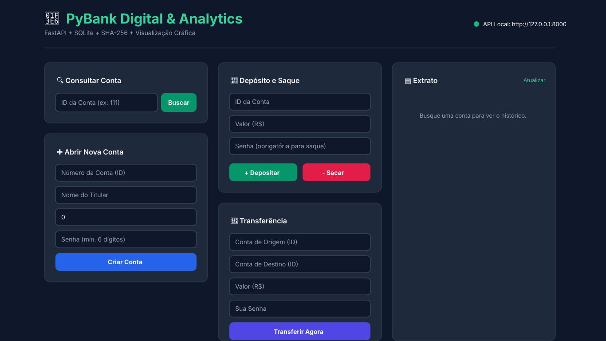

# 🏦 PyBank Digital & Analytics — API Bancária



Aplicação demonstrativa de gerenciamento de contas bancárias desenvolvida em Python com FastAPI, SQLite e um painel web interativo.

## Funcionalidades

- API REST com documentação automática em `/docs`.
- Criação de contas e autenticação HTTP Basic.
- Consulta de saldo, depósitos, saques, transferências e extrato.
- Transferências atômicas e saldos armazenados em centavos para evitar erros de arredondamento.
- Dashboard responsivo com gráfico de evolução financeira.
- Senhas protegidas com PBKDF2-HMAC-SHA256 e salt individual. SHA-256 puro não é adequado para armazenamento de senhas.

## Tecnologias

Python 3.10+, FastAPI, Uvicorn, SQLite, Pydantic, HTML, Tailwind CSS e Chart.js.

## Instalação e execução

```bash
git clone https://github.com/MadmacBR/PyBANK.git
cd PyBANK
python -m venv .venv
# Linux/macOS: source .venv/bin/activate
# Windows: .venv\\Scripts\\activate
pip install -r requirements.txt
uvicorn app.main:app --reload
```

Abra <http://127.0.0.1:8000> para o painel e <http://127.0.0.1:8000/docs> para a documentação interativa. A base SQLite `app/pybank.db` é criada automaticamente. Para escolher outro caminho, defina `PYBANK_DB`.

## Endpoints

| Método | Caminho | Descrição |
| --- | --- | --- |
| `POST` | `/accounts` | Criar conta (sem autenticação) |
| `GET` | `/accounts/me` | Consultar conta e saldo |
| `POST` | `/transactions/deposit` | Depositar |
| `POST` | `/transactions/withdraw` | Sacar |
| `POST` | `/transactions/transfer` | Transferir para outra conta |
| `GET` | `/transactions` | Consultar extrato (parâmetro `limit`, máximo 500) |
| `GET` | `/transactions/evolution` | Consultar pontos do gráfico de saldo |

As rotas, exceto criação de conta e health check, usam HTTP Basic com número da conta como usuário e senha cadastrada. Use HTTPS fora do ambiente local.

## Aviso

Este é um projeto educacional, não uma instituição financeira nem um sistema pronto para produção. Para produção, adicione controles de abuso (rate limiting e bloqueio progressivo), gestão de segredos, auditoria, backups, testes, monitoramento e revisão de segurança; utilize HTTPS e um mecanismo de autenticação apropriado para sua implantação.
